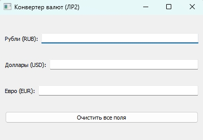
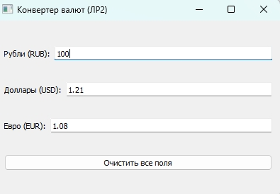
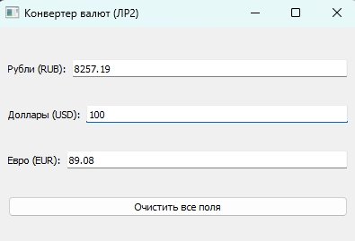
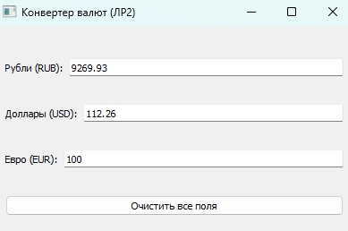

# Лабораторная работа №2

**Выполнила:** *Некрасова Дарья Вадимовна*  
**Группа:** *6233-010402D*  

---

## Задание

> Сделать окно с полями ввода курс доллар - рубль - евро. Один меняется — должны меняться все остальные.

В методичке был предложен макет `l2discuss` (классы `cl1`, `cl2`, `main`), по которому нужно было нарастить функционал. В рамках работы реализован конвертер валют с использованием собственных сигналов и слотов.

---

## Описание работы

Приложение реализовано на Python 3 с использованием библиотеки PyQt5. Архитектура разделена на несколько модулей:

- **`converter.py`** — виджет с интерфейсом и логикой пересчёта.
- **`sig_dollar.py`, `sig_euro.py`, `sig_ruble.py`** — собственные сигналы для каждой валюты.
- **`sig_control.py`** — служебный сигнал для очистки полей.
- **`main.py`** — точка входа, собирает все компоненты вместе.

Функционал:

- Окно с тремя полями ввода: «Рубли (RUB)», «Доллары (USD)», «Евро (EUR)».
- При вводе числа в любое из полей — остальные два **автоматически пересчитываются** (данные подтягиваются из API, если сети нет - используется базовый курс).
- Кнопка «Очистить все поля» сбрасывает значения.

---
## Требования

- Python 3.6+
- PyQt5

---

## Скриншоты

### 1. Начальное состояние окна

### 2. Пересчёт из рублей

### 3. Пересчёт из долларов

### 4. Пересчёт из евро
