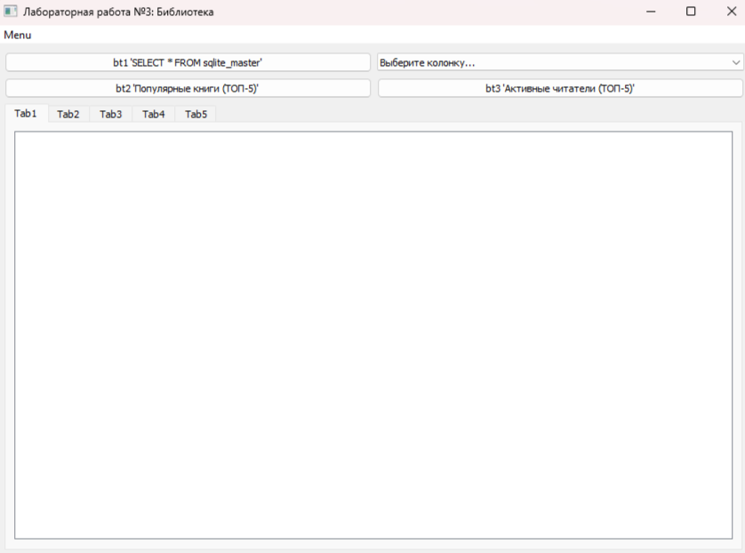
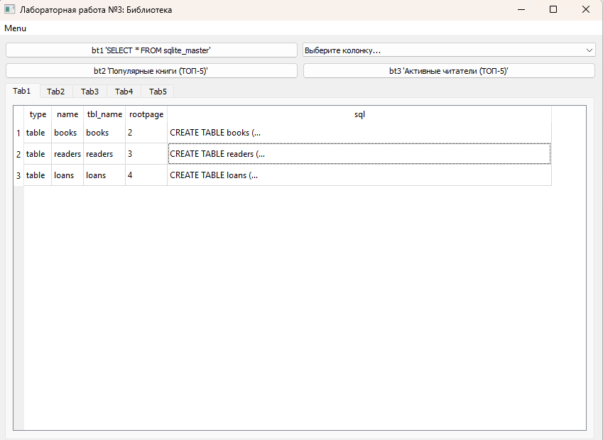
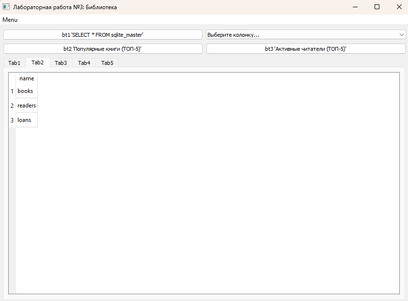
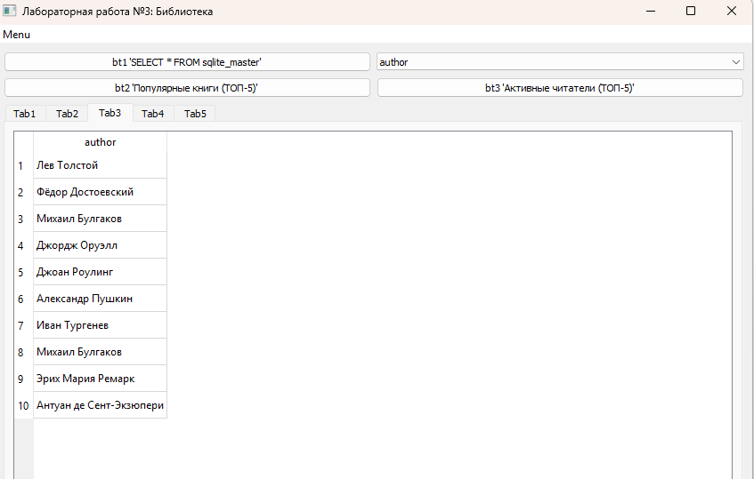
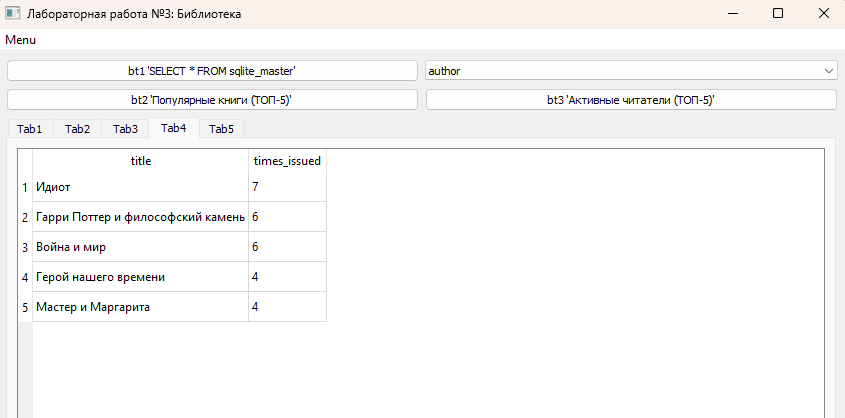
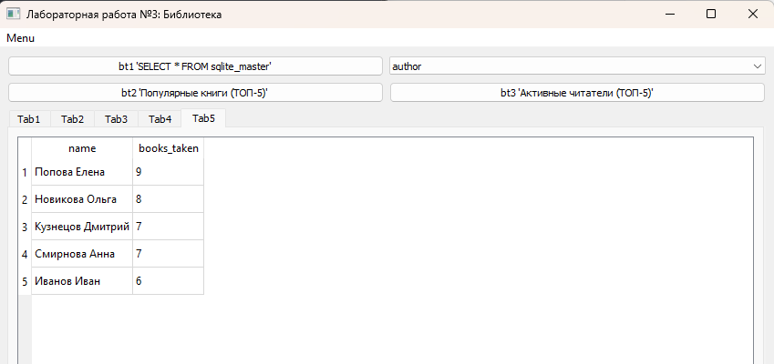

# Лабораторная работа №3

**Выполнила:** *Некрасова Дарья Вадимовна*  
**Группа:** *6233-010402D*  

---

## Описание работы

Приложение реализовано на Python 3 с использованием библиотеки PyQt5. Для работы с базой данных используется модуль `QtSql` (классы `QSqlDatabase`, `QSqlQuery`). В качестве СУБД выбрана SQLite.

В качестве предметной области выбрана **библиотека**. База данных `library.db` содержит три таблицы:
* `books` — книги (название, автор, год).
* `readers` — читатели (ФИО, email).
* `loans` — выдачи книг (связка книги и читателя, дата выдачи).

Структура проекта:
* `main.py` — интерфейс, меню и логика выполнения SQL-запросов.
* `db_generator.py` — скрипт для генерации тестовой базы данных (создает `library.db` и заполняет её).

---

## Реализованные запросы и элементы управления

**Меню (Menu):**
* **Set connection** — открывает диалоговое окно `QFileDialog` для выбора файла базы данных (`.db` или `.sqlite`). После успешного подключения автоматически выполняется запрос для заполнения `Tab1` и загружается список колонок из первой таблицы в `QComboBox`.
* **Close connection** — закрывает соединение с базой данных, очищает все вкладки `QTabWidget` и сбрасывает выпадающий список.

**Панель управления и вкладки:**
* **Выпадающий список `QComboBox`** — содержит названия колонок.  
  * *Результат:* выводится в **Tab3**.

* **Кнопка `bt1 'SELECT * FROM sqlite_master'`** — выполняет системный запрос для получения списка всех объектов в базе. 
  * *Результат:* выводится в **Tab2** (список всех таблиц и индексов базы).

* **Кнопка `bt2 'Популярные книги (ТОП-5)'`** — выполняет аналитический запрос с объединением таблиц (`JOIN`) и группировкой (`GROUP BY`), чтобы узнать, какие книги брали чаще всего.

  * *Результат:* выводится в **Tab4** (таблица из двух колонок: название книги и сколько раз её брали).

* **Кнопка `bt3 'Активные читатели (ТОП-5)'`** — выполняет аналитический запрос для выявления самых активных читателей.

  * *Результат:* выводится в **Tab5** (имя читателя и количество взятых им книг).
 
 **Автоматический запрос:**

* **Tab1** — заполняется сразу после подключения к базе данных.

---
## Скриншоты

### 1. Начальное состояние окна (до подключения БД)

### 2. Вывод структуры БД (Tab1 после подключения)

### 3. Результат нажатия на кнопку bt1 (Tab2)

### 4. Результат выбора колонки (Tab3)

### 5. Популярные книги (Tab4)

### 6. Активные читатели (Tab5)
